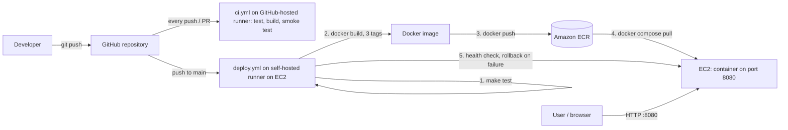

# DevOps Intern Task

A minimal Go web app, packaged as a small Docker image and deployed to AWS EC2 by a CI/CD pipeline (GitHub Actions → Amazon ECR → EC2).

`GET /` returns:

```json
{"message": "Hello from DevOps Intern Task!", "status": "running"}
```

**Quick start** (needs only Docker):

```bash
git clone https://github.com/mhkhanBTech/devops-intern-task.git
cd devops-intern-task
docker compose up --build
curl http://localhost:8080/
```

## Contents
- [Project structure](#project-structure)
- [Run the app with docker-compose](#run-the-app-with-docker-compose)
- [Run the tests](#run-the-tests)
- [Architecture diagram](#architecture-diagram)
- [CI/CD pipeline](#cicd-pipeline)
- [Image tags and versioning](#image-tags-and-versioning)
- [How would you deploy this container to AWS?](#how-would-you-deploy-this-container-to-aws)
- [Docker best practices applied](#docker-best-practices-applied)
- [Git conventions](#git-conventions)
- [Notes for reviewers](#notes-for-reviewers)

## Project structure
```
.
├── main.go                        # web app (single endpoint "/")
├── main_test.go                   # unit tests
├── go.mod
├── Dockerfile                     # multi-stage: deps -> test -> build -> final
├── docker-compose.yml             # runs the app on port 8080
├── Makefile                       # shortcuts for build / test / run
├── .github/workflows/
│   ├── ci.yml                     # test + build + smoke test (GitHub-hosted runner)
│   └── deploy.yml                 # test, build, push to ECR, deploy (self-hosted runner on EC2)
├── .dockerignore
└── .gitignore
```

## Run the app with docker-compose

**Requirements:** Docker with the Compose plugin. `make` is optional.

**1. Start the app** (builds the image the first time):

```bash
docker compose up --build
```

With the older standalone tool the command is `docker-compose up --build`. Add `-d` to run in the background.

**2. Check that it works** (in another terminal):

```bash
curl http://localhost:8080/
# {"message":"Hello from DevOps Intern Task!","status":"running"}
```

**3. Stop and remove the container:**

```bash
docker compose down
```

**Shortcuts with make** (run `make help` for the full list):

| Command | What it does |
|---|---|
| `make up` | build and start in the background |
| `make test` | run `go vet` and the unit tests inside Docker |
| `make docker-build` | build the production image |
| `make health` | show the container health status |
| `make size` | show the image size |
| `make down` | stop and remove the container |

## Run the tests

```bash
make test
```

This builds the `test` stage of the Dockerfile, which runs `go vet` and `go test`. No Go installation is needed.

## Architecture diagram



## CI/CD pipeline

There are two workflows:

| Workflow | Runs on | When | What it does |
|---|---|---|---|
| `ci.yml` | GitHub-hosted runner | every push and pull request | test, build the image, start it and smoke test it |
| `deploy.yml` | self-hosted runner on EC2 | push to `main`, only in the owner's repository | test, build, push to ECR, deploy, health check |

**Steps of `deploy.yml`:**

| Step | What happens |
|---|---|
| 1. Checkout | fetch the code and git history |
| 2. Test | `make test`. A failing test stops the pipeline |
| 3. Tag | read the commit SHA and build number |
| 4. ECR login | `aws ecr get-login-password`, using the EC2 IAM role (no stored keys) |
| 5. Build | multi-stage `docker build --target final`, one image with three tags |
| 6. Push | push all three tags to Amazon ECR (`ap-southeast-2`) |
| 7. Remember | record the image that is running now (used for rollback) |
| 8. Deploy | `docker compose pull` from ECR, then `docker compose up -d` |
| 9. Health check | `curl` the app up to 10 times. On failure the previous image is restored |
| 10. Clean up | remove unused images older than 24 hours |

## Image tags and versioning

The pipeline builds **one image** and gives it **three tags** (`-t` is used three times in the build step). All three are pushed to ECR, and the server pulls the build-number tag.

| Tag | Example | Why it exists |
|---|---|---|
| Build number | `1.0.<run_number>` | readable version. **The server pulls and deploys this tag** |
| Commit SHA | `<short-sha>` | traces an image back to the exact commit and makes rollbacks easy |
| `latest` | `latest` | always points to the newest build, for quick manual pulls |

The build number and commit are also compiled into the binary (printed in the startup log) and stored in the image labels.

**Check what is running on the server:**

```bash
docker inspect --format '{{.Config.Image}}' devops-intern-task   # full ECR image name and tag
docker logs devops-intern-task 2>&1 | head -3                    # version=1.0.N commit=<sha>
docker ps --format "table {{.Names}}\t{{.Status}}"               # shows (healthy)
```

## How would you deploy this container to AWS?
- **Build once, store in a registry.** The pipeline builds the image, tags it with a build number and commit SHA, and pushes it to Amazon ECR. The server never builds code. It only pulls a ready, versioned image.
- **Run it on EC2 with Docker Compose.** An Ubuntu EC2 instance with an IAM role pulls the image from ECR and starts it with `docker compose`. The security group opens only port 8080 (and SSH from my IP). A self-hosted runner on the instance performs the deploy after every push to `main`.
- **Make deploys safe and repeatable.** A health check runs after each deploy, and the previous image is restored if it fails. Every image has a unique tag, so I can roll back by redeploying an older tag. For production I would restrict the instance role to ECR permissions only, put a load balancer in front, and consider ECS Fargate to avoid managing the server.

## Docker best practices applied

**Layering**
- `go.mod` is copied and dependencies downloaded before the source code, so code changes do not re-download modules
- BuildKit cache mounts speed up rebuilds
- `.dockerignore` keeps the build context small

**Small image**
- Multi-stage build: the Go toolchain stays in the build stage
- Static binary (`CGO_ENABLED=0`, `-s -w`, `-trimpath`) in a distroless image (no shell, no package manager)
- About 14 MB on disk (about 3 MB of content). Check with `make size`

**Container hygiene**
- Runs as a non-root user (UID 65532)
- Read-only filesystem, all capabilities dropped, `no-new-privileges`
- `HEALTHCHECK` without curl (the binary has a `-healthcheck` flag)
- Graceful shutdown and HTTP server timeouts
- Memory, CPU and PID limits and log rotation in `docker-compose.yml`
- Pinned base image versions and OCI labels (version, commit, build date)

## Git conventions
Commits follow [Conventional Commits](https://www.conventionalcommits.org/): `feat:`, `fix:`, `docs:`, `test:`, `chore:`, `ci:`. Each commit does one thing, and releases are tagged (for example `v1.0.0`).

## Notes for reviewers
- **Pipeline runs:** open the repository's **Actions** tab to see every run with its logs (test, ECR push, deploy, health check).
- **Why `deploy.yml` does not run in forks:** it needs the author's self-hosted runner and AWS account, so it is limited to this repository. Forks and pull requests run `ci.yml` on GitHub-hosted runners instead.
- **Runner security:** fork pull request workflows require approval for all external contributors, and deployment runs only on `push` to `main`.
- **AWS access:** the EC2 instance uses an IAM role to reach ECR, so no AWS access keys are stored in GitHub.
